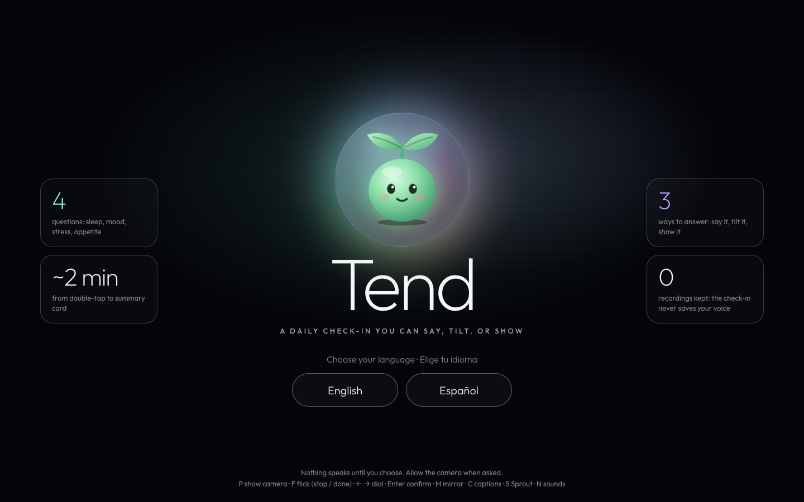
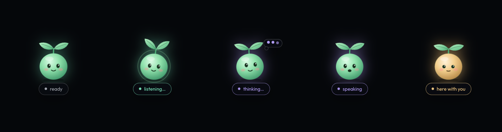
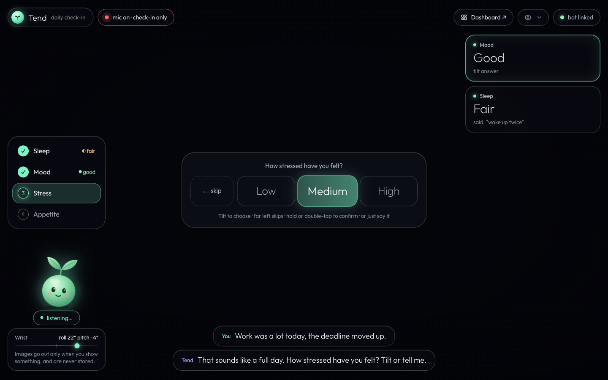
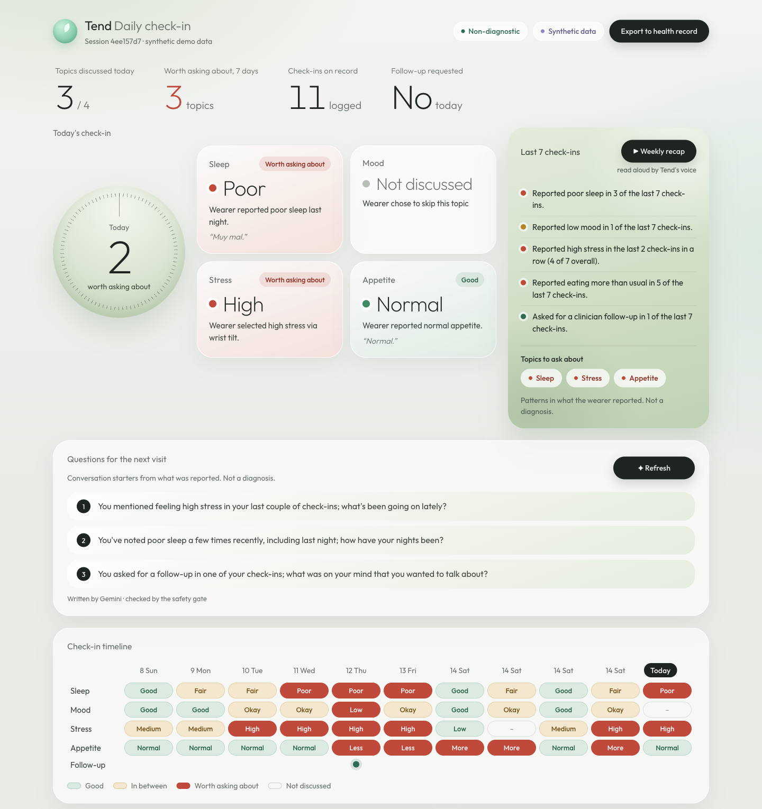
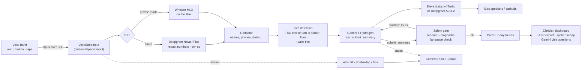

# Tend 🌱
### A daily wellbeing check-in you can **say, tilt, or show**: on a wrist band, in under two minutes.

*By NeuroKind · built at VexoHacks (Vexo × Y Combinator, Nov 14 2026)*



Clinicians see their patients every few weeks. What happens in between (a run of bad nights, a stressful week,
skipped meals) mostly goes unrecorded, or gets squeezed into a rushed "how have you been?" at the next visit.
Wearables measure the body, not how someone *feels*, and questionnaires get skipped.

**Tend** fills that gap. The wearer double-taps their Vexo band and a warm voice asks how their day was, then
about **sleep, mood, stress and appetite**, one at a time, with a natural follow-up when something happened.
They can answer out loud, **tilt their wrist** to pick an answer without speaking, or **show** the camera their
lunch. Tend turns that into a **structured, non-diagnostic card** a clinician can scan in seconds, with a
**record of where every piece of data went**.

> Tend reports only what the wearer said. It never diagnoses, interprets, or gives medical advice, and a local
> safety gate enforces that before anything reaches the clinician.

---

## Meet Sprout



Sprout is Tend's face: a small seedling, because you *tend* a plant. It shows the wearer, at a glance, what the
voice agent is doing, so the conversation never feels like talking into a void.

| State | When | What Sprout does |
|---|---|---|
| **ready** | waiting for the wearer | breathes slowly, blinks |
| **listening** | the wearer is speaking | leaves perk up, leans toward the captions |
| **thinking** | Gemini is preparing a reply | sways, thought dots |
| **speaking** | Tend's voice is playing | gentle bounce, mouth moves |
| **here with you** | the wearer mentioned self-harm | goes still and warm amber; no bouncing at a serious moment |

Sprout is driven live by the voice pipeline (Pipecat's turn and speech events), not by a timer.

---

## What it does

**For the wearer**
- 🗣️ **Voice-first check-in:** "How was your day?" → one natural follow-up when something happened → sleep, mood,
  stress, appetite → "anything else?" → "would you like a clinician to follow up?"
- 🤚 **No voice needed:** tilt the wrist to move a dial, **hold 2 s** to confirm (or double-tap), **tilt far left
  to skip**. Double-tap answers "nothing to add". Built for people who don't use speech, or not all the time.
- ⌨️ **Tell me more, your way:** when a tilt answer is worth asking about (poor sleep, low mood…), the dial turns
  into *"Tell me more?"*: tilt left to **say it**, right to **type it**, or stay put for no thanks. Typed words go
  through the same redaction, safety gate and provenance log as speech, and can be quoted on the card.
- ✋ **Wrist flick:** flick while Tend is talking and it stops; flick after you speak and it answers right away.
- 📷 **Show, don't tell:** "here's my lunch" attaches one camera frame; Gemini notes the objects only (never people).
- 🌎 **English or Español**, chosen on the first screen; nothing speaks until you choose. With Deepgram Flux,
  **Spanglish** works too ("dormí bad, honestly"). The clinician's card stays in English, with quotes kept in
  the wearer's own words.
- 🔔 **Little sounds from Sprout:** a soft chime when an answer is confirmed, a pop for skip, a shimmer for the
  streak, a whoosh when a flick stops Tend talking (`N` mutes).
- 🙆 **Stretch reminders:** after the check-in, if the band feels your wrist barely moving for a while, Sprout
  stretches and Tend suggests a quick stretch; Sprout cheers when you move. The card counts these as *measured by
  the band*, kept apart from what the wearer said. (Demo: 15 s; a real setting would be closer to an hour, with a
  phone app keeping the band connected all day.)
- 🌱 **Streaks:** "Day 7 in a row". Tend thanks you once, at goodbye.

**For the clinician**
- 📋 **Card in seconds:** per-topic level + neutral paraphrase + the wearer's own words, plus a 7-day timeline and
  "topics to ask about" (patterns in what was *reported*, never a diagnosis).
- 🚩 **Escalation:** if self-harm comes up, Tend responds warmly, mentions 988, and the card is flagged for the care team.
- 💬 **Questions for the next visit:** Gemini turns the week's reported patterns (levels only: no quotes, no
  names) into 2–3 open conversation starters, e.g. *"You've noted poor sleep a few times recently, including last
  night; how have your nights been?"* Each one passes the same safety gate; flagged wording goes back to Gemini
  to rewrite.
- 🔊 **▶ Weekly recap**, read aloud in Tend's voice: handy right before an appointment.
- 🏥 **Export to health record:** one click produces a standard **FHIR R4** `QuestionnaireResponse` an EHR can import.
- 🔍 **Where the data went:** every hop (band → transcription → redaction → Gemini → safety gate → card) is logged
  without the content itself.




---

## How it works



| Piece | What we did |
|---|---|
| **Custom wearable input for Pipecat** | `VexoBandInput` decodes the band's Opus packets into 16 kHz PCM frames, so the band is a first-class Pipecat transport. |
| **Deepgram Flux, multilingual** | `--stt flux` runs `flux-general-multi` with language hints (the chosen language first), so mixed English/Spanish lands in one transcript. Flux's own end-of-turn detection drives the conversation through Pipecat's external turn strategies, and the wrist flick still overrides it. |
| **Turn-taking for a noisy room** | Silero VAD + local Smart Turn, capped at 1.5 s of silence; a **wrist flick** ends the turn instantly. The mic is muted while Tend talks, so its own voice can't cut it off (we measured 3 self-interruptions/min before, 0 after). |
| **One reply at a time** | Voice, wrist and typing all feed the same conversation, so Tend makes sure only one reply plays: the dial pauses while you talk (voice wins), a wrist answer waits until Tend finishes its sentence, a reply that went stale because you kept talking is dropped before it's spoken, and the band mic hearing Tend's own voice is ignored. |
| **Self-correcting tool calls** | Gemini fills a strict card schema via `submit_summary`; if the safety gate finds diagnostic language ("shows signs of insomnia"), Gemini gets the exact fix list and resubmits. |
| **Live HUD state** | A small processor turns Pipecat's speaking events into Sprout's states; voice answers and corrections ("change my appetite to normal") update the screen as they're said. |
| **Two voices, one switch** | ElevenLabs Eleven v4 Turbo by default; `--tts deepgram` swaps in Deepgram Aura-2 (`helena` in English, `celeste` in Spanish) with no other change. |
| **Measured latency** | Gemini 4 Hydrogen first token ~1.2–2 s; Deepgram Aura-2 first audio ~0.11 s; ElevenLabs ~0.18 s; flick-to-silence ~10 ms. |

---

## Privacy and safety by design

- **Redaction before the LLM:** names, phone numbers, addresses and dates are removed on the Mac before any text
  reaches Gemini (English and Spanish). Deepgram additionally redacts numbers, card numbers and SSNs.
- **Private mode** (`--stt whisper`): audio and transcription never leave the Mac; only redacted text does.
- **Raw audio is never written to disk** by the bot. Camera frames are kept in memory only, one at a time.
- **Non-diagnostic by construction:** a local safety gate checks every card (and every spoken recap) for
  diagnostic language before it is saved. Quotes of the wearer's own words are exempt.
- **Debug logs hold timing, not words:** each run's log (`logs/`, owner-only, kept 3 days) records when Tend
  replied and how long the reply was, never what was said.
- **Provenance log:** every hop is recorded (what kind of data, from where, to where, when), never the content.
- **Local web server hardening:** the HUD and dashboard bind to 127.0.0.1, refuse foreign Origins and Host
  headers (DNS rebinding), and serve only the dashboard's own data files.
- **Synthetic data only** in this demo.

---

## Sponsor tracks we're going for

| Track | Why Tend fits |
|---|---|
| **Deepgram: Best Voice Use Case on Pipecat** | A full Pipecat pipeline with a **custom wearable input transport**. Deepgram end to end: streaming STT with built-in redaction and keyterms, **Flux multilingual** for Spanglish with Flux's own end-of-turn detection, and **Aura-2** as Tend's voice in English and Spanish. Turn-taking is tuned for a wrist mic in a loud room, with gesture-driven turn control (flick to end or interrupt). |
| **Google DeepMind: Best Use of Gemini 4** | Gemini 4 Hydrogen runs the conversation and fills a strict schema through **tool calling with self-correction** against a safety gate; **multimodal** (one camera frame when the wearer shows their meal); speaks Spanish while writing the clinician's card in English; writes **visit questions** for the clinician that pass the same gate, rewriting itself when flagged. |
| **ElevenLabs: Best ElevenLabs Project** | Tend's whole personality is its voice: **Eleven v4 Turbo** (~0.18 s to first audio) for the live check-in, the same voice reading the **weekly recap** on the clinician dashboard, and a **multilingual** check-in. |

---

## From hackathon to the real world

### A day in the life (proposed workflow)

1. **Enroll:** a clinic enrolls a patient in Tend, sets which topics matter for them, and the patient consents
   to what is shared and with whom.
2. **Check in:** once a day, the patient double-taps the band. Two minutes, by voice, by wrist, or both.
3. **Triage:** the clinician's dashboard shows only what changed: "Reported poor sleep 4 nights in a row".
   Self-harm mentions are flagged to the care team immediately; the wearer hears 988 right away.
4. **Before the visit:** the clinician plays the 30-second weekly recap or opens the 7-day timeline, so the
   appointment starts from what actually happened.
5. **Into the record:** one click exports a FHIR `QuestionnaireResponse` into the EHR, so the check-ins live
   next to the rest of the chart.
6. **Between visits:** streaks keep the habit going; the patient can always skip a topic or ask for a call.

### Real-world benefits

- **Better visits:** clinicians walk in with two weeks of the patient's own words instead of one rushed recollection.
- **Earlier conversations:** a pattern in what was reported ("eating less than usual, 5 days running") surfaces
  between visits, not at the next one.
- **Lower burden than forms:** two minutes of conversation instead of a questionnaire; no screen needed.
- **Inclusive by default:** works without speech (wrist dial), in Spanish, and fully on-device in private mode.
- **Trust built in:** non-diagnostic output, redaction before the LLM, and a visible record of where data went.

### Business

- **Who pays:** behavioral-health and primary-care practices, care-management programs, and employers' wellbeing
  programs; later, senior-living and home-care providers.
- **Model:** B2B SaaS, per enrolled patient per month, with the band supplied through the hardware partner.
  In the US, remote-monitoring reimbursement may cover part of the cost for clinics; this needs validation
  for self-reported check-ins.
- **Why now:** low-latency voice AI (sub-second speech, ~2 s replies) finally makes a *conversation* on a wearable
  feel natural, and clinicians are short on time between visits.
- **Edge:** a voice-first and no-voice (wrist) check-in on a device people already wear; output designed for
  clinicians (structured, non-diagnostic, FHIR-ready); privacy and provenance as product features, not fine print.
- **What we'd validate next:** check-in completion over 30 days; clinician time saved per visit; regulatory
  positioning (staying non-diagnostic); vendor agreements for health data (BAAs); accuracy of the wrist-only path.

---

## Run it

```bash
cd ~/Desktop/neurokind && source .venv/bin/activate      # Python 3.12 venv
cp env.example .env                                      # add Deepgram, Google, ElevenLabs keys
python check_all.py                                      # checks keys + Gemini latency

python hud_bot.py 1 --max-minutes 5        # real band #1 (double-tap it first) + camera HUD
python hud_bot.py --sim --max-minutes 2    # no band: the kit's pretend band
python hud_bot.py 1 --stt flux --tts deepgram --max-minutes 5   # all-Deepgram: Flux (Spanglish) + Aura-2 voice
python neurokind_bot.py 1 --stt whisper    # voice-only bot, private mode (audio stays on the Mac)
```
Open **http://localhost:8765**, pick a language, and talk. The clinician dashboard is at
**http://localhost:8765/dashboard** (or the 📋 button on the HUD). `python trends.py --seed` writes 6 days of
synthetic history.

**HUD keys** (for rehearsing without the band): `F` flick · `←` `→` dial · `Enter` confirm / nothing to add ·
`P` show camera · `S` cycle Sprout · `M` mirror · `C` captions · `N` sounds on/off · `T` stretch reminder.

**Tests:** `python tests/test_voice_levels.py` · `python tests/test_streak.py`

## Repo map

| File | What it is |
|---|---|
| `neurokind_bot.py` | Voice-only Pipecat bot: band → STT → redaction → Gemini → ElevenLabs |
| `hud_bot.py` | The full experience: camera HUD, Sprout, wrist dial, flick, language picker, streaks |
| `hud_server.py` | Local web server: HUD, dashboard, spoken recap, visit questions, WebSocket (localhost only) |
| `hud.html` · `card.html` | Wearer HUD · clinician dashboard (plain HTML/JS) |
| `guardrails.py` | Redaction, provenance log, safety gate |
| `trends.py` | 7-day patterns in what was reported |
| `band_capture.py` | Single-turn mic test with speech detection and audio quality checks |
| `make_sounds.py` · `sounds/` | Sprout's sound effects (ElevenLabs Sound Effects when the key allows, else synthesized locally) |
| `pinch_probe.py` | An experiment we ran and dropped (below) |

### What we tried and dropped
**Pinch to confirm.** We streamed the band's accelerometer at 416 samples/s to detect a thumb-index pinch. The
band *does* feel it (70–390 mg spikes vs ~4 mg at rest), but everyday movement is bigger (taps and claps over
1,400 mg), and the fast stream caused Bluetooth audio gaps. We kept hold-to-confirm instead. `pinch_probe.py`
reruns the test in one minute.

---

*Tend is a hackathon prototype for wellbeing check-ins. It is not a medical device and does not diagnose or
treat any condition. If you or someone you know is struggling, call or text 988 (US).*
